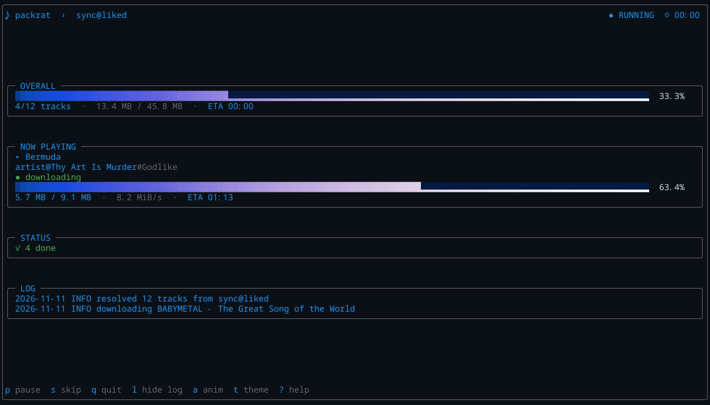
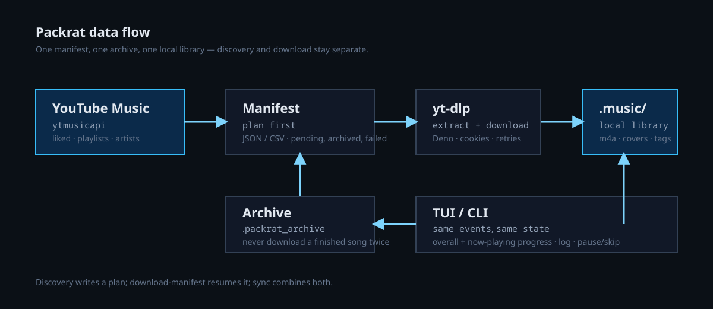

<p align="center">
  <strong>README</strong> · <a href="docs/INSTALL.md">Install</a> · <a href="docs/QUICKSTART.md">Quickstart</a> · <a href="docs/COMMANDS.md">Commands</a> · <a href="docs/AUTH.md">Auth</a> · <a href="docs/CONFIGURATION.md">Configuration</a>
</p>
<p align="center">
  <a href="docs/TUI.md">TUI</a> · <a href="docs/DISCOVERY.md">Discovery</a> · <a href="docs/ARTISTS.md">Artists</a> · <a href="docs/TROUBLESHOOTING.md">Troubleshooting</a> · <a href="docs/DEVELOPMENT.md">Development</a> · <a href="docs/HISTORY.md">History</a>
</p>

<h1 align="center">packrat</h1>

<p align="center"><em>Like a little packrat, stash your YouTube Music library offline.</em></p>

<p align="center">
  
  
  
</p>



Packrat is a local-first YouTube Music downloader. It syncs Liked Songs and
playlists, builds artist catalogs, plans discovery runs, and downloads through
`yt-dlp` into a plain `~/Music/PackratMidden/` folder. Every run is backed by a manifest and an
archive, so it is safe to stop, resume, and retry.

## Why Packrat?

> A **pack rat** or **packrat**, also called a **woodrat** or **trade rat**, are any species in the North and Central American rodent genus ***Neotoma***. Pack rats have a rat-like appearance, with long tails, large ears, and large, black eyes. Pack rats are noticeably larger than deer mice, harvest mice, and grasshopper mice, and are usually somewhat larger than cotton rats.
<p align="right">• <a href="https://en.wikipedia.org/wiki/Pack_rat">Pack Rat</a>, <i>Wikipedia</i> </p>

- **Liked Songs and playlists**: sync once, keep the archive, never re-download finished tracks.
- **Artist catalogs**: albums, singles and top songs, with an interactive release picker and a non-interactive `--select` grammar.
- **Discovery plans**: sections, taste-adjacent, radio queues, albums and radio, always written to a manifest before downloading.
- **A real TUI**: rounded frame, smooth HSL progress bars, log panel, pause/skip, themes, and tmux-aware palettes.
- **Local-first layout**: `~/Music/PackratMidden/`, JSON manifests, `.m3u8` playlists and a simple archive; no database.
- **Recoverable by design**: failed tracks are recorded, `download-manifest` resumes, and `--failed-only` retries only failures.

## Quick start

```bash
# 1.a) Remote install (review the script first, don't run random scripts plz):
curl -fsSL https://raw.githubusercontent.com/gnoooo/packrat/refs/heads/master/install.sh | bash
# 1.b) Install from the repository (same thing, review the script before): 
git clone https://github.com/gnoooo/packrat.git && cd packrat
./install.sh
# 1.c) Or manually:
python -m venv .venv && source .venv/bin/activate && pip install -e .

# 2. Save your YouTube Music login
packrat login
packrat auth
packrat doctor

# 3. Preview, then download
packrat sync --limit 5 --dry-run
packrat sync --limit 5

# 4. Prefer the full-screen view?
packrat --tui sync --source liked
```

Files go to `~/Music/PackratMidden/<Artist>/<Album>/<NN - Title>.m4a`; singles go to
`~/Music/PackratMidden/<Artist>/Singles/`. Finished video IDs go to `~/.config/packrat/archive`.

## Commands

| Command | What it does |
|---|---|
| `packrat login` / `auth` / `logout` | Create, verify or delete the login file. |
| `packrat doctor` | Check dependencies, credentials and an optional online canary. |
| `packrat export-metadata` | Export normalized JSON/CSV metadata from a plan. |
| `packrat library` | List playlists. |
| `packrat sync` | Sync Liked Songs or a playlist. |
| `packrat download-one LINK_OR_ID` | Download one song and verify it. |
| `packrat download-manifest` (`resume`) | Resume or retry a saved plan. |
| `packrat artist` | Download an artist catalog or selected releases. |
| `packrat discover sections` | Home, Charts, Moods and New Releases. |
| `packrat discover taste` | Deep catalog, similar artists, radio, Last.fm. |
| `packrat discover queues` | Radio-queue playlists. |
| `packrat discover albums` | Albums from your top artists. |
| `packrat discover radio SEED` | One radio station. |

Every command supports `--help`; common options can appear before or after the
subcommand. See [Commands](docs/COMMANDS.md) for the full reference.

## Documentation

| Guide | Start here if… |
|---|---|
| [Install](docs/INSTALL.md) | you are setting up Python, ffmpeg or Deno. |
| [Quickstart](docs/QUICKSTART.md) | you want the shortest path to a first download. |
| [Commands](docs/COMMANDS.md) | you need the command and option reference. |
| [Auth](docs/AUTH.md) | login, cookies or age-restricted tracks are failing. |
| [Configuration](docs/CONFIGURATION.md) | you want to change paths, archive or pacing. |
| [TUI](docs/TUI.md) | you want the full-screen view, themes or tmux colors. |
| [Discovery](docs/DISCOVERY.md) | you want planned recommendations. |
| [Artists](docs/ARTISTS.md) | you want a catalog or the release picker. |
| [Troubleshooting](docs/TROUBLESHOOTING.md) | something failed and you need the log. |
| [Development](docs/DEVELOPMENT.md) | you are changing Packrat or running tests. |
| [History](docs/HISTORY.md) | you want the design and migration history. |

## How it fits together



Discovery and sync write a **manifest** first. The downloader resolves each
track, checks the **archive**, downloads with yt-dlp, and updates the manifest
as it goes. The TUI and CLI consume the same event stream, so a run looks the
same whether it is headless or full-screen.

## Common options

```text
--output/-o DIR     # library root (default: ~/Music/PackratMidden)
--archive FILE      # download history (default: ~/.config/packrat/archive)
--delay SEC         # pause between tracks (default: 7.0)
--max-size SIZE     # skip oversized tracks, e.g. 3GB
--limit N           # download at most N new tracks
--dry-run/-n        # plan only
--yes/-y            # skip confirmation
--tui               # full-screen progress view
```

Environment equivalents are documented in
[Configuration](docs/CONFIGURATION.md). Old `YTM_*` variables and the old
`ytm-offline` command remain as compatibility fallbacks.

## TUI at a glance

The TUI uses a rounded outer frame, a header/footer, and a progress-bar one for OVERALL and NOW PLAYING. 


- `p` pause, `s` skip, `q` quit, `l` log, `a` animation, `t` theme, `?` help
- Themes: `ocean`, `sunset`, `matrix`, `mono`
- Palettes: `auto`, `fixed`, `basic`; tmux 3.7+ gets exact OSC 4 colours
- `--ascii`, `--no-color` and `--no-anim` for minimal terminals

Read [TUI](docs/TUI.md) for the layout, keys and tmux notes.

## Development

```bash
source .venv/bin/activate
python -m pytest
```

The test suite blocks real network access. The local bare mirror, shared hooks
and signed release workflow are documented in
[Development](docs/DEVELOPMENT.md); design history is in
[History](docs/HISTORY.md).

Security/integrity work in this phase:

- login files are owner-only, config directories are 0700, and `logout` deletes the saved headers
- logs redact `Cookie`, `Authorization`, `SID`/`HSID`/`SSID`/`APISID`/`SAPISID` and `__Secure-*` values
- manifests and the archive are written atomically
- a valid existing file is treated as already downloaded
- audio files are parsed with mutagen before being marked complete
- `packrat doctor --online` runs a small YouTube Music + yt-dlp canary.

## Security

Never commit `browser.json`, `cookies*.txt`, headers files, `~/Music/PackratMidden/`,
`~/.config/packrat/archive`, or logs. Config/state stays outside the repository. See [Auth](docs/AUTH.md) for
the cookie model.

---

<p align="center"><sub>packrat: local-first YouTube Music, without the lock-in.</sub></p>
