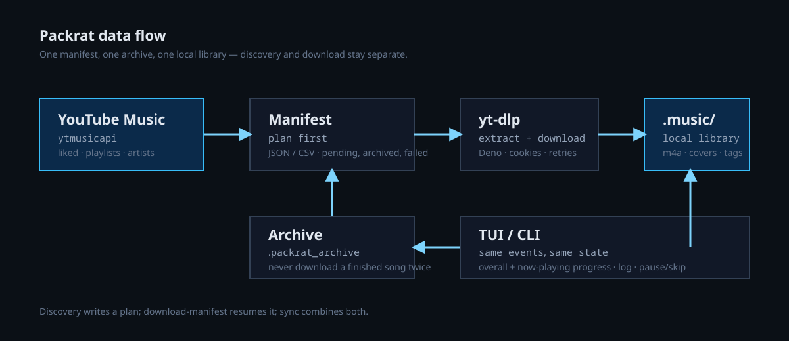

# Development

<p align="center">
  <a href="../README.md">README</a> · <a href="INSTALL.md">Install</a> · <a href="QUICKSTART.md">Quickstart</a> · <a href="COMMANDS.md">Commands</a> · <a href="AUTH.md">Auth</a> · <a href="CONFIGURATION.md">Configuration</a>
</p>
<p align="center">
  <a href="TUI.md">TUI</a> · <a href="DISCOVERY.md">Discovery</a> · <a href="ARTISTS.md">Artists</a> · <a href="TROUBLESHOOTING.md">Troubleshooting</a> · <strong>Development</strong> · <a href="HISTORY.md">History</a>
</p>

## Architecture



```text
src/packrat/
  cli.py, cli_args.py         # CLI parsing and command dispatch
  sync.py, batch.py           # track lists, manifests, download loop
  download.py                 # one-track yt-dlp wrapper + idempotency
  integrity.py                # mutagen audio integrity check
  security.py                 # credential permissions/removal
  services/                   # credentials, diagnostics, metadata export
  artists.py                  # artist catalog + picker
  discover*.py, queues.py     # discovery planners
  tui.py, tui_theme.py        # curses renderer and palette
  archive.py, manifest.py     # state on disk
tests/                        # pytest suite, network blocked
docs/                         # user documentation and images
dev/hooks/                    # shared git hooks
```

## Tests

```bash
source .venv/bin/activate
python -m pytest
```

The suite blocks real network connections (`tests/conftest.py`). Use mocks or
local fixtures for anything that would hit YouTube Music.

## Releases and CI

The release workflow is [`.github/workflows/release.yml`](../.github/workflows/release.yml).
It runs on every push to `master` (and can be started manually):

1. `uv lock --check`
2. `uv sync --frozen --extra dev`
3. `uv run --frozen pytest`
4. build wheel + sdist
5. sign `SHA256SUMS` with GPG
6. create/push a tag
7. publish a GitHub release

### Stable vs snapshot releases

- If the remote does not have `v<version>` yet, the push creates the **stable**
  release `v<version>`.
- Otherwise the push creates a **prerelease snapshot**
  `v<version>.dev<run-number>+<short-sha>`.

Bump `pyproject.toml` to create the next stable release:

```bash
# edit version = "0.4.0"
uv lock
git add pyproject.toml uv.lock
git commit -m "release: 0.4.0"
git push github master
```

The workflow uses `uv.lock`; commit it whenever dependencies or the project
version change.

### Signing setup

The workflow requires a GPG private key in repository secrets. Generate a
dedicated release key:

```bash
gpg --full-generate-key          # sign-only key is enough
KEYID="$(gpg --list-secret-keys --with-colons | awk -F: '/^sec:/ {print $5; exit}')"
gpg --armor --export-secret-keys "$KEYID" > /tmp/packrat-release.asc
gh secret set GPG_PRIVATE_KEY < /tmp/packrat-release.asc
gh secret set GPG_PASSPHRASE     # if the key has a passphrase
gh secret set GPG_KEY_ID --body "$KEYID"
gpg --armor --export "$KEYID" > docs/release-key.asc
```

Commit `docs/release-key.asc`; never commit the private key. The future
`packrat upgrade` command will verify `SHA256SUMS.asc` against this public key.
The release workflow fails if `GPG_PRIVATE_KEY` is missing.

### Release artifacts

```text
packrat-<version>-py3-none-any.whl
packrat-<version>.tar.gz
SHA256SUMS
SHA256SUMS.asc
release-key.asc
```

Tags and releases are immutable; never move a published tag.

## Local bare mirror

In my configuration, I have a local cloud with Nextcloud, and it can be messy syncing a `.git` folder. 
That's why the `local` remote points at `~/Nextcloud/Documents/git/packrat.git`. 
Shared hooks mirror commits, amended history and merges in the background:

```bash
./dev/hooks/install.sh
```

`core.hooksPath` becomes `dev/hooks`. A failed push is silent; the next commit
retries all branches. Tags are not mirrored.

## Documentation

- [README.md](../README.md): landing page and navbar
- `docs/*.md`: focused guides
- `docs/images/`: TUI screenshots and architecture diagram

## Verification and credentials

- `integrity.verify_audio()` checks size, parseability and duration before a file is treated as complete.
- `download_track()` skips a valid existing destination and quarantines invalid files before retrying.
- `security.secure_file()` / `secure_directory()` enforce owner-only modes; `logout` removes saved headers.
- `doctor` is the regression canary for YouTube/yt-dlp changes.

## Performance notes

- Sync/discovery use duration-based size estimates; they do not run yt-dlp
  once per track before downloading.
- Artist catalogs resolve kept releases with a small worker pool and skip
  excluded releases for non-interactive downloads.
- Downloads are still sequential; the default 7 s delay is deliberate pacing.

## Release checklist

```bash
python -m pytest
packrat --version
git status
```

Keep credentials, `~/Music/PackratMidden/`, `.packrat_archive` and logs out of commits.
