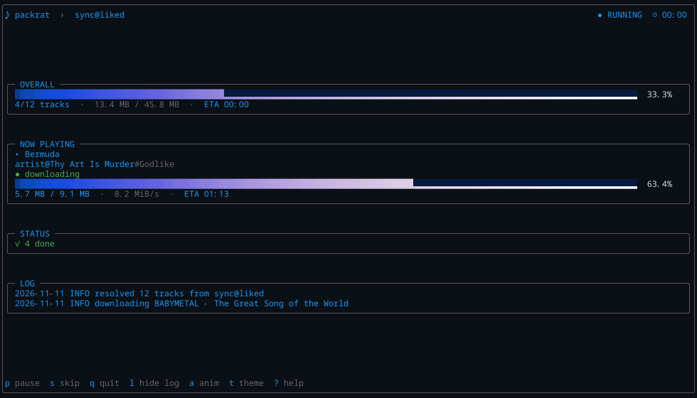

# Quickstart

<p align="center">
  <a href="../README.md">README</a> · <a href="INSTALL.md">Install</a> · <strong>Quickstart</strong> · <a href="COMMANDS.md">Commands</a> · <a href="AUTH.md">Auth</a> · <a href="CONFIGURATION.md">Configuration</a>
</p>
<p align="center">
  <a href="TUI.md">TUI</a> · <a href="DISCOVERY.md">Discovery</a> · <a href="ARTISTS.md">Artists</a> · <a href="TROUBLESHOOTING.md">Troubleshooting</a> · <a href="DEVELOPMENT.md">Development</a> · <a href="HISTORY.md">History</a>
</p>

## Before you start

- Python 3.11+
- `ffmpeg` and `ffprobe`
- Deno 2.3+ recommended for YouTube's JavaScript challenges

Run `packrat doctor` to check all of them.

## 1. Log in

```bash
packrat login
```

The command explains how to copy request headers from a logged-in `music.youtube.com` tab.
It writes `~/.config/packrat/browser.json` by default.

`login` verifies the file immediately. Re-run `packrat auth` later if you want
to check that the session is still valid.

## 2. Preview a sync

```bash
packrat sync --limit 5 --dry-run
```

This resolves Liked Songs, builds a manifest, and prints the pending count and
size without downloading anything. The manifest lists the individual tracks.

## 3. Download

```bash
packrat sync --limit 5
```

Files land in `~/Music/PackratMidden/<Artist>/<Album>/<NN - Title>.m4a` (singles use `~/Music/PackratMidden/<Artist>/Singles/`).
Finished video IDs are added to `~/.config/packrat/archive`.

## 4. Use the full-screen view

```bash
packrat --tui sync --source liked
```



Keys: `p` pause, `s` skip, `q` quit, `l` log, `a` animation, `t` theme,
`?` help. See [TUI](TUI.md).

## 5. Resume or retry

```bash
packrat download-manifest                 # newest plan in ~/Music/PackratMidden/playlists/
packrat download-manifest --failed-only   # retry failures only
```

## Download one song

```bash
packrat download-one "https://music.youtube.com/watch?v=..."
```

## Download a playlist

```bash
packrat library --top 10
packrat sync --source "playlist:<link-or-ID>" --limit 20
```

## Next

- [Commands](COMMANDS.md): full command reference
- [Auth](AUTH.md): cookies and private tracks
- [Configuration](CONFIGURATION.md): paths, archive, environment
