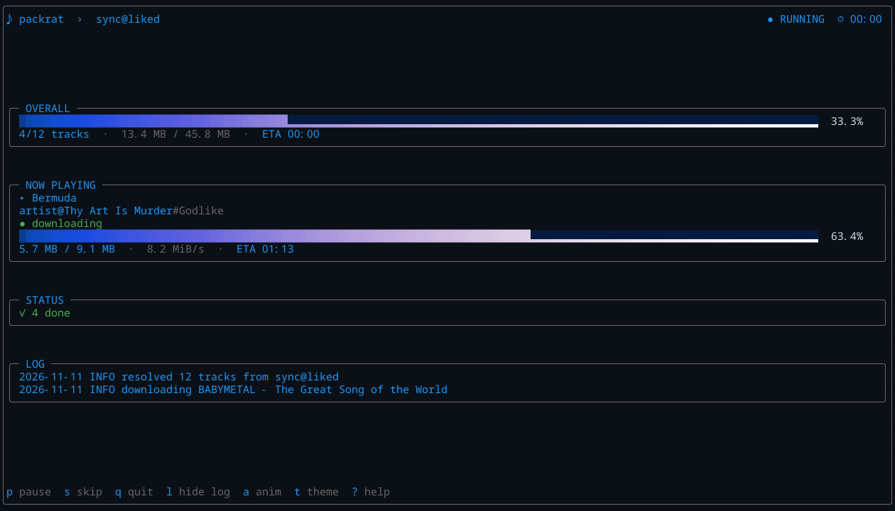
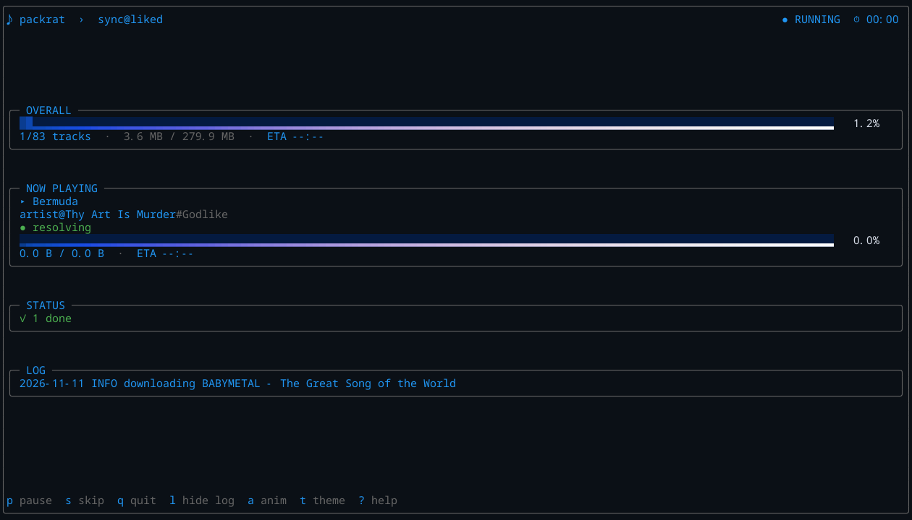

# TUI

<p align="center">
  <a href="../README.md">README</a> · <a href="INSTALL.md">Install</a> · <a href="QUICKSTART.md">Quickstart</a> · <a href="COMMANDS.md">Commands</a> · <a href="AUTH.md">Auth</a> · <a href="CONFIGURATION.md">Configuration</a>
</p>
<p align="center">
  <strong>TUI</strong> · <a href="DISCOVERY.md">Discovery</a> · <a href="ARTISTS.md">Artists</a> · <a href="TROUBLESHOOTING.md">Troubleshooting</a> · <a href="DEVELOPMENT.md">Development</a> · <a href="HISTORY.md">History</a>
</p>

The full-screen curses UI is optional. Add `--tui` to `sync`,
`download-manifest`, `artist`, `discover queues`, `discover albums`, or
`discover radio`.

```bash
packrat --tui sync --source liked
```



## Keys

| Key | Action |
|---|---|
| `p` / space | pause or resume |
| `s` | skip current track |
| `q` | quit after the current track |
| `l` | toggle the log panel |
| `a` | toggle animations |
| `t` | cycle theme |
| `?` | help |
| Up/Down, PgUp/PgDn | scroll the log |

## Layout

A rounded outer frame surrounds the whole TUI. Inside it:

- foreground-only header (`♪ packrat › mode`, status, elapsed)
- centered card stack: OVERALL, NOW PLAYING, STATUS, RECENT FAILURES, LOG
- foreground-only key footer

Content is capped at 200 columns. Cards are vertically centered when the
terminal is tall enough; the log appears by default on terminals at least 30
rows tall.

## Progress bars

Both bars share one renderer. The gradient runs across the full bar width:

- filled tiles: full `█` blocks with the gradient as foreground
- track tiles: quarter-height `▂` with the same gradient
- the active/head tile is a solid gradient block, not a forced white tip

At low progress the track still shows the gradient:



## Themes

```bash
packrat --tui --theme ocean sync     # default
packrat --tui --theme sunset sync
packrat --tui --theme matrix sync
packrat --tui --theme mono sync
```

## Palettes

- `--palette auto`: exact palette when supported; inside tmux uses OSC 4 (tmux 3.7+), otherwise nearest xterm-256.
- `--palette fixed`: nearest xterm-256; useful for limited terminals.
- `--palette basic`: low-color attributes; 256-color terminals may still use a gradient bar.

For tmux, use `tmux-256color`:

```tmux
set -g default-terminal "tmux-256color"
```

The TUI logs the selected palette at startup:

```text
TUI palette tier=custom method=osc4 ...
```

If the log says `tier=fixed`, the exact palette is unavailable.

## Display options

```bash
packrat --tui --no-anim sync       # disable animation
packrat --tui --no-color sync      # monochrome
packrat --tui --ascii sync         # ASCII glyphs
```

`PACKRAT_TUI_ANIM=0` also disables animation.

## Logs

The log card shows recent log lines. `l` hides or shows it. Logs are also
written to `~/.config/packrat/logs/packrat-*.log`; use `-v` for more detail.
